# DIGITAL FORENSICS LAB: INTERACTIVE CYBERSECURITY INCIDENT INVESTIGATION AND EVIDENCE ANALYSIS SIMULATOR

## A MINI-PROJECT REPORT

*Submitted in partial fulfilment of the award of the degree of*

### BACHELOR OF ENGINEERING  
### IN  
### COMPUTER SCIENCE AND ENGINEERING  

---

### Submitted by:
**VS THAMIZHSELVAN 240701805**

---

### RAJALAKSHMI ENGINEERING COLLEGE
**(An Autonomous Institution Affiliated to ANNA UNIVERSITY, Chennai)**  
**AUTONOMOUS, CHENNAI**  

**OCTOBER, 2026**

---
\pagebreak

## BONAFIDE CERTIFICATE

Certified that this mini-project **“Digital Forensics Lab”** is the bonafide work of **“VS Thamizhselvan (240701805)”** who carried out the project work under my supervision.

<br><br><br>

**SIGNATURE**  
**Dr. N. DURAIMURUGAN**  
Assistant Professor,  
Computer Science & Engineering  
Rajalakshmi Engineering College  
Thandalam, Chennai - 602105.  

<br><br>

Submitted for the End semester practical examination to be held on: ____________________

<br><br>

**INTERNAL EXAMINER** &emsp;&emsp;&emsp;&emsp;&emsp;&emsp;&emsp;&emsp;&emsp;&emsp;&emsp;&emsp;&emsp; **EXTERNAL EXAMINER**

---
\pagebreak

## ACKNOWLEDGEMENT

I express my sincere thanks to our Chairman, Chairperson, and the management for their timely support and for providing an academic environment that enabled the successful completion of this mini-project.

I am grateful to our Principal for guidance and leadership throughout the project.

I thank the Head of Department and Academic Coordinators for their support during planning and completion. Their guidance helped me maintain progress and encouraged me at each stage.

I extend my sincere thanks to my internal project guide, **Dr. N. DURAIMURUGAN**, Assistant Professor, Department of Computer Science and Engineering, for valuable guidance and motivation during implementation and completion of the project.

Finally, I thank my parents, family, friends, and faculty members for their constant support and encouragement.

<br>

**VS Thamizhselvan (240701805)**

---
\pagebreak

## ABSTRACT

In modern enterprise computing environments, digital investigations and incident response have become critical safeguards against data breaches, insider threats, credential compromises, and malware outbreaks. However, traditional digital forensics training often relies on complex, monolithic virtual machine installations that demand steep hardware overhead and present prohibitive configuration barriers for students and aspiring analysts.

**Digital Forensics Lab** is a high-fidelity, interactive cybersecurity incident investigation and evidence analysis simulator designed to bridge the gap between abstract theoretical principles and authentic practical investigations. Built with a pure client-side, dependency-free architecture utilizing standard HTML5, modern CSS3 with custom properties, and modular ES6+ JavaScript, the platform runs instantly in any modern web browser without server backend dependencies.

The simulator provides three comprehensive real-world forensic cases: unauthorized credential access and confidential data exfiltration (*The Midnight Access*), insider tampering and anti-forensic deletion (*The Missing Files*), and executive account takeover via rogue devices (*The Unknown Device*). Analysts inspect heterogeneous raw logs (Web SSO, Linux syslog, bash history, reverse proxy telemetry, and file metadata), verify chain-of-custody checksums using cryptographic **SHA-256** digests, correlate events across an interactive chronological timeline, formulate investigative findings, test their analytical reasoning through scenario challenges, and automatically generate formal, audit-ready incident response reports.

By combining rigorous forensic workflows with accessible pedagogical scaffolding, Digital Forensics Lab delivers a standardized, practical, and engaging platform for academic laboratories and cybersecurity education.

---
\pagebreak

## TABLE OF CONTENTS

| Chapter No. | Title | Page No. |
| :---: | :--- | :---: |
| | **ABSTRACT** | **iv** |
| **1** | **INTRODUCTION** | **1** |
| | 1.1 Introduction | 1 |
| | 1.2 Scope of the Work | 1 |
| | 1.3 Problem Statement | 2 |
| | 1.4 Aim and Objectives of the Project | 2 |
| **2** | **SYSTEM SPECIFICATIONS** | **3** |
| | 2.1 Hardware Specifications | 3 |
| | 2.2 Software Specifications | 3 |
| **3** | **ARCHITECTURE DIAGRAM** | **4** |
| **4** | **MODULE DESCRIPTION** | **5** |
| | 4.1 Dashboard and Telemetry Overview Module | 5 |
| | 4.2 Incident Dossiers & Multi-Scenario Simulation Module | 5 |
| | 4.3 Evidence Locker & Cryptographic Integrity Verification Module | 5 |
| | 4.4 Chronological Event Timeline Correlation Module | 6 |
| | 4.5 Findings, Hypothesis & Red-Flag Board Module | 6 |
| | 4.6 Scenario Challenge & Incident Report Generation Module | 6 |
| **5** | **SYSTEM DESIGN** | **7** |
| | 5.1 Use Case Diagram | 7 |
| | 5.2 Data Model (In-Memory Forensic Schema) | 8 |
| | 5.3 Data Flow Diagrams (Context Level-0 & Decomposed Level-1) | 9 |
| | 5.4 Activity Diagram | 10 |
| **6** | **SAMPLE CODING** | **11** |
| | 6.1 Evidence Locker & Raw Syslog/JSON Inspector | 11 |
| | 6.2 Chronological Timeline Reconstruction Engine | 12 |
| | 6.3 Findings Board & Hypothesis State Management | 13 |
| | 6.4 Executive Incident Report Synthesis Engine | 14 |
| **7** | **SCREEN SHOTS** | **15** |
| | Fig. 7.1 Dashboard Overview and Case Metrics | 15 |
| | Fig. 7.2 Incident Case Selection and Dossier View | 15 |
| | Fig. 7.3 Evidence Locker and Hash Integrity Verification | 16 |
| | Fig. 7.4 Interactive Incident Timeline Reconstruction | 16 |
| | Fig. 7.5 Findings and Red Flags Board | 17 |
| | Fig. 7.6 Incident Response Knowledge Challenge | 17 |
| | Fig. 7.7 Official Incident Investigation Report | 18 |
| **8** | **CONCLUSION & FUTURE ENHANCEMENTS** | **19** |
| | 8.1 Conclusion | 19 |
| | 8.2 Future Enhancements | 19 |
| | **REFERENCES** | **20** |

---
\pagebreak

# CHAPTER 1: INTRODUCTION

### 1.1 INTRODUCTION
Digital Forensics and Incident Response (DFIR) constitutes a foundational pillar of modern cybersecurity operations. As distributed enterprises, cloud platforms, and remote workstations handle ever-growing volumes of proprietary data, organizations face persistent threats from credential stuffers, rogue employees, and advanced persistent threat actors. 

Conducting authentic forensic investigations requires analysts to reconstruct chronological narratives, verify digital chain-of-custody, examine system and network logs without alteration, distinguish corroborated facts from intuitive speculation, and document findings in audit-compliant deliverables.

However, traditional academic training environments face severe hurdles: setting up hypervisors, disk image forensic suites (e.g., Autopsy, FTK), and sandboxed network targets demands extensive computing hardware, specialized licensing, and prolonged configuration time. **Digital Forensics Lab** overcomes these challenges by delivering an accessible, browser-native forensic simulation terminal that models realistic security operations with zero software installation requirements.

### 1.2 SCOPE OF THE WORK
The scope of the Digital Forensics Lab mini-project encompasses:
1. Developing an interactive, browser-executable cybersecurity forensic simulator with a modern dark-mode terminal user interface.
2. Modeling realistic multi-source forensic datasets across three primary enterprise incident scenarios: unauthorized credential misuse, anti-forensic log deletion, and hardware token spoofing.
3. Supplying an **Evidence Locker** that pairs authentic raw JSON and syslog records with cryptographic **SHA-256** checksums and plain-English mentor explanations.
4. Constructing an interactive **Event Timeline** allowing chronological ordering and anomaly filtering across disparate server, network, and file-system artifacts.
5. Providing a **Findings & Hypothesis Board** where students formulate evidence-backed conclusions and distinguish facts from unverified assumptions.
6. Supplying interactive **Knowledge Challenges** with immediate scenario-grounded scoring feedback.
7. Automating the synthesis of verified investigative actions into exportable and printable **Incident Investigation Reports**.

### 1.3 PROBLEM STATEMENT
Conventional cybersecurity instruction and digital forensics laboratories exhibit three major pedagogical and operational deficiencies:
* **High Infrastructure Barrier:** Traditional forensic tools require high-performance multi-gigabyte virtual machines and proprietary licenses, restricting laboratory accessibility for students with standard hardware.
* **Abstract Theoretical Pedagogy:** Standard academic curricula frequently focus heavily on abstract legal guidelines and theoretical formulas without offering immersive, exploratory engagement with raw telemetry.
* **Lack of Guided Interpretive Scaffolding:** Novice investigators confronted with raw RFC 5424 syslog or Windows Security Event logs encounter intimidating syntax hurdles without contextual guidance, slowing the acquisition of investigative intuition.

Digital Forensics Lab directly addresses these challenges by encapsulating enterprise-grade forensic analysis workflows inside a zero-dependency, intuitive, client-side web application.

### 1.4 AIM AND OBJECTIVES OF THE PROJECT
* **Primary Aim:** To design and implement a zero-dependency, client-side digital forensics and incident investigation simulator that enables hands-on evidence examination, timeline reconstruction, and automated report synthesis in modern web browsers.
* **Key Objectives:**
  * To architect an accessible, modular single-page application utilizing semantic HTML5, cyber-themed responsive CSS3, and ES6+ JavaScript.
  * To generate three realistic forensic case studies containing structured evidence artifacts, raw telemetry payloads, and cryptographic integrity hashes.
  * To build an interactive chronological event timeline that correlates authentication, network proxy, and file system logs.
  * To implement a structured investigative methodology separating raw facts from formulated conclusions on an interactive findings board.
  * To design an automated report synthesis engine that compiles investigation metrics, evidence summaries, and examiner signatures into a standardized deliverable.

---
\pagebreak

# CHAPTER 2: SYSTEM SPECIFICATIONS

### 2.1 HARDWARE SPECIFICATIONS
* **Processor:** Intel Core i3 / AMD Ryzen 3 or higher (Fully compatible with Apple Silicon M1/M2/M3/M4)
* **Memory (RAM):** 4 GB RAM minimum; 8 GB recommended
* **Storage:** 500 MB free disk space (Completely zero database footprint)
* **Display Resolution:** 1280 × 720 minimum (Responsive across desktop, laptop, and tablet viewports)

### 2.2 SOFTWARE SPECIFICATIONS
* **Operating System:** Windows 10/11, macOS Monterey or later, or Linux (Ubuntu 20.04+)
* **Front-End Technologies:**
  * **HTML5:** Semantic architecture, accessible ARIA landmarks, dialog modals
  * **CSS3:** Custom Properties (Neon cyber tokens), Flexbox, CSS Grid, Glassmorphic panels, CSS Paged Media (`@media print`)
  * **JavaScript:** Modern ECMAScript 2022 (ES6+), Modular state architecture, DOM manipulation
* **APIs & Web Standards Used:**
  * **Web Storage API:** `window.localStorage` for saving investigator progress and notes
  * **Clipboard API:** `navigator.clipboard.writeText()` for raw log extraction
  * **CSS Paged Media API:** Native `@media print` styling for PDF and paper report generation
* **Web Browser:** Google Chrome 90+, Mozilla Firefox 88+, Microsoft Edge 90+, or Apple Safari 14+

The application requires only a modern standard-compliant browser. All computation and state manipulation occur in the client interface with zero backend network communication.

---
\pagebreak

# CHAPTER 3: ARCHITECTURE DIAGRAM

The architecture follows a strict **Client-Side Isolated Simulation Pipeline**. Case telemetry, log records, and user hypotheses remain strictly in browser volatile memory and local storage.


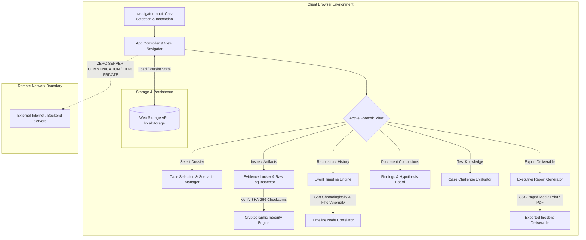

---
\pagebreak

# CHAPTER 4: MODULE DESCRIPTION

### 4.1 DASHBOARD AND TELEMETRY OVERVIEW MODULE
The dashboard serves as the central command console for the investigator. It presents real-time investigation metrics including overall completion percentage, evidence items reviewed, red-flags tagged, and current investigator rank (from *Junior Security Analyst* up to *Chief Forensic Investigator*). Quick-launch buttons allow immediate resumption of ongoing investigations.

### 4.2 INCIDENT DOSSIERS & MULTI-SCENARIO SIMULATION MODULE
This module provides curated, realistic forensic case studies:
* **DF-2024-001 (The Midnight Access):** Investigates unauthorized confidential file downloads outside business hours via compromised Single Sign-On (SSO) credentials.
* **DF-2024-002 (The Missing Files):** Explores insider threat activity involving suspicious bash scripts, mass file deletions, and bash history wiping attempts.
* **DF-2024-003 (The Unknown Device):** Reconstructs an executive account compromise facilitated by rogue network hardware and concurrent remote IP access.

### 4.3 EVIDENCE LOCKER & CRYPTOGRAPHIC INTEGRITY VERIFICATION MODULE
The evidence locker manages all digital artifacts collected during an incident. Each artifact displays metadata including source daemon, UTC timestamp, event severity, and plain-English translations. An integrated raw telemetry modal displays exact syslog or JSON payloads alongside **SHA-256** checksums, allowing students to verify cryptographic chain of custody and understand how raw records correlate with higher-level alerts.

### 4.4 CHRONOLOGICAL EVENT TIMELINE CORRELATION MODULE
This module sorts disparate log events from authentication servers, network reverse proxies, and host file systems into a unified chronological sequence. Users can sort ascending or descending by epoch timestamps, filter exclusively for suspicious red-flag events, and visually trace the trajectory of an attack from initial reconnaissance to objective execution.

### 4.5 FINDINGS, HYPOTHESIS & RED-FLAG BOARD MODULE
Investigative integrity requires differentiating proven facts from unverified assumptions. The findings board enables analysts to tag observed anomalies, record working hypotheses regarding threat actor tactics, track analytical confidence, and write case notes in an integrated investigator notebook.

### 4.6 SCENARIO CHALLENGE & INCIDENT REPORT GENERATION MODULE
* **Scenario Challenge:** Evaluates the student's root-cause attribution, identifying true indicators of compromise and recommending prioritized remediation actions with instant grading.
* **Incident Report Generator:** Synthesizes verified case facts, inspected evidence tables, confirmed findings, and examiner credentials into an audit-ready deliverable ready for printing or PDF export.

---
\pagebreak

# CHAPTER 5: SYSTEM DESIGN

### 5.1 USE CASE DIAGRAM
The use case diagram illustrates investigator interactions with the Digital Forensics Lab system boundary.

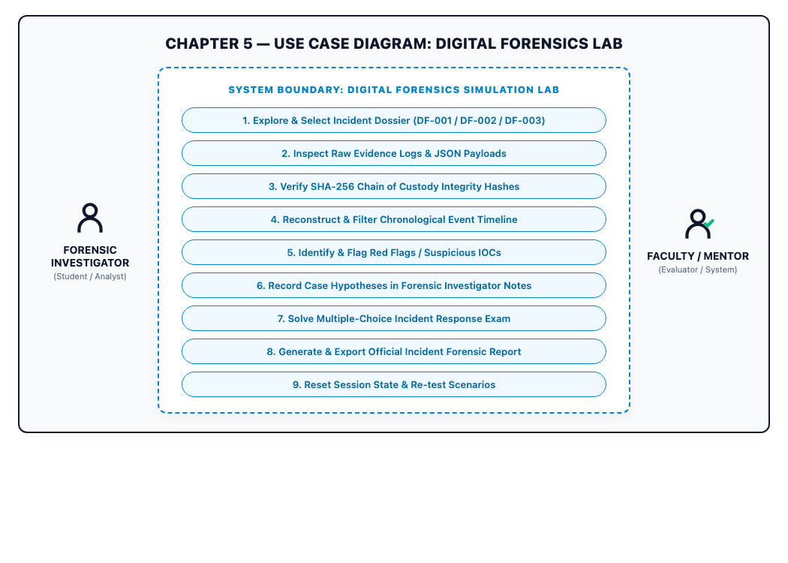

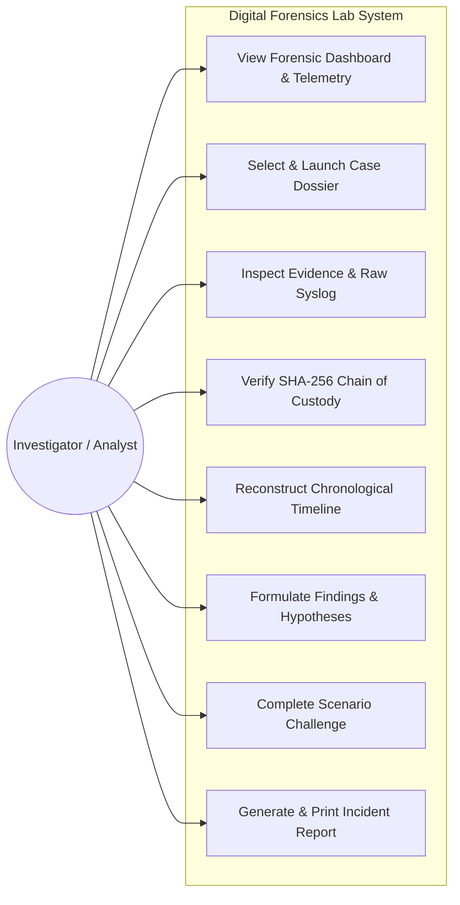

### 5.2 DATA MODEL (IN-MEMORY FORENSIC SCHEMA)
The data model defines the structural schema governing cases, evidence artifacts, findings, and persisted investigator state.

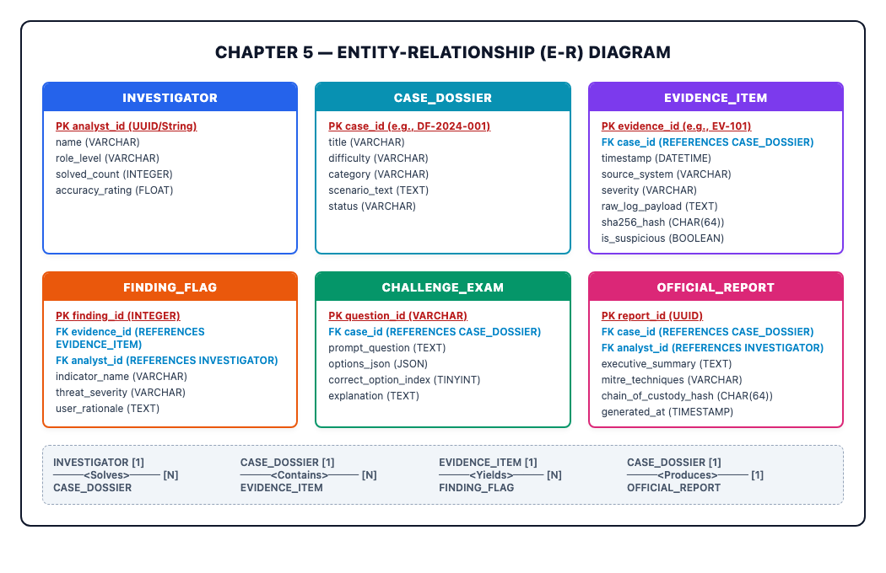

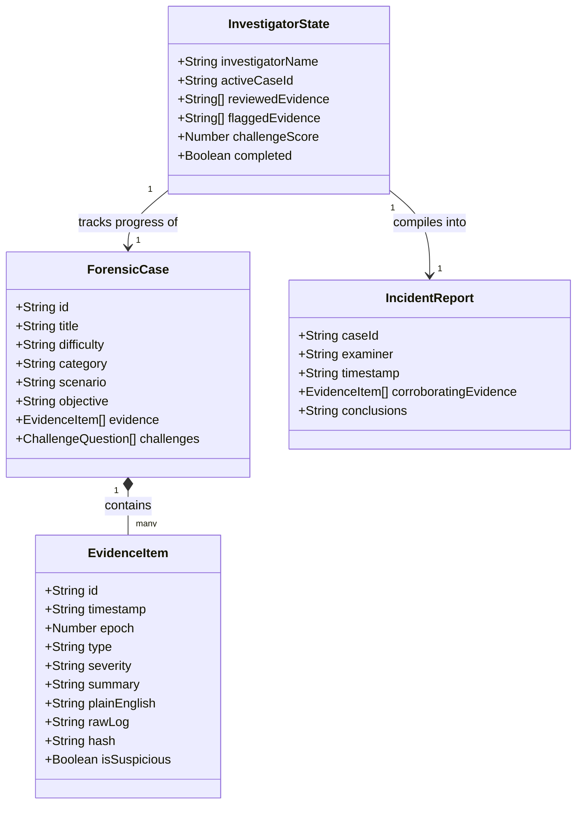

### 5.3 DATA FLOW DIAGRAMS

#### Level-0 DFD (Context Diagram)
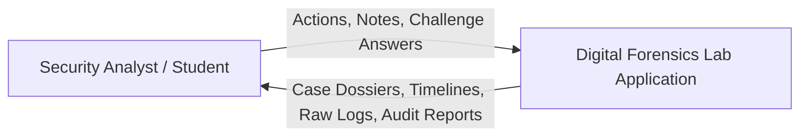

#### Level-1 DFD (Decomposed System Flow)
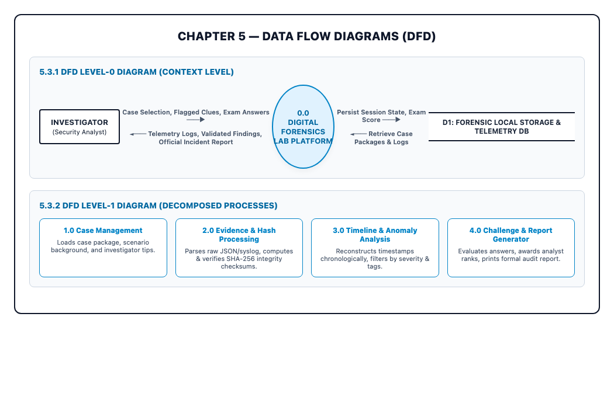

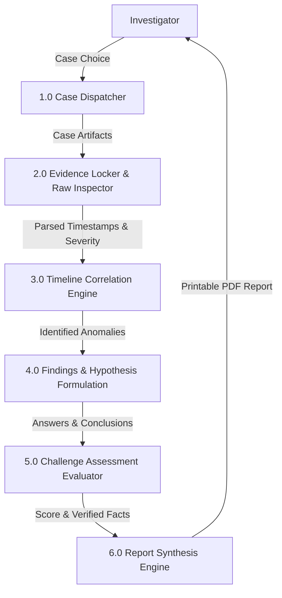

### 5.4 ACTIVITY DIAGRAM
The activity diagram tracks the investigative lifecycle from case briefing through evidence correlation and report export.

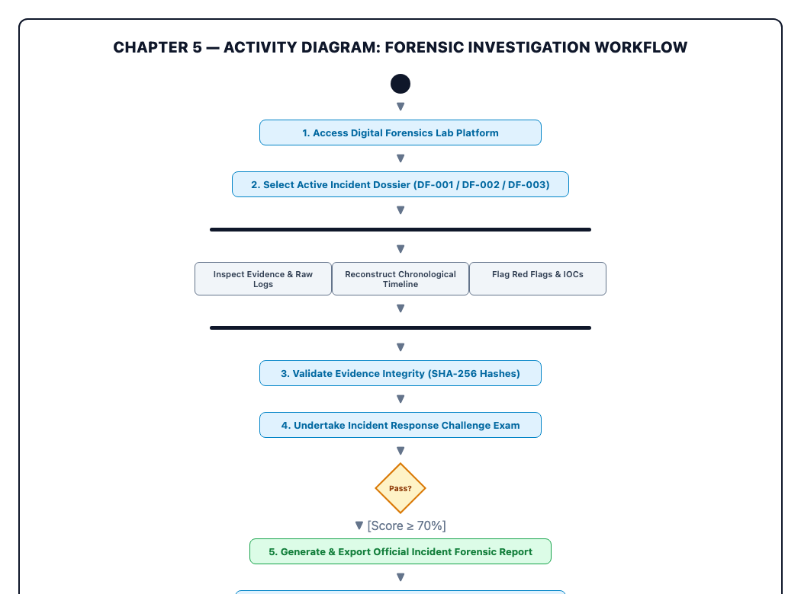

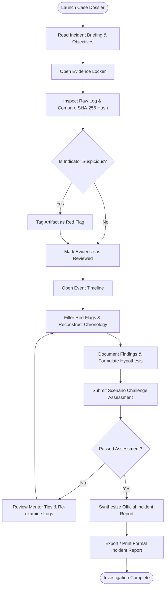

---
\pagebreak

# CHAPTER 6: SAMPLE CODING

### 6.1 Evidence Locker & Raw Syslog/JSON Inspector (`script.js`)
```javascript
/**
 * Inspects a specific evidence artifact, presents formatted metadata,
 * renders the raw syslog/JSON payload, and displays cryptographic hashes.
 */
function inspectEvidence(evidenceId) {
  const activeCase = getActiveCase();
  const item = activeCase.evidence.find(e => e.id === evidenceId);
  if (!item) return;

  const progress = getActiveProgress();
  if (!progress.reviewedEvidence.includes(item.id)) {
    progress.reviewedEvidence.push(item.id);
    saveState();
    updateGlobalStats();
    updateStepperUI();
  }

  // Populate Inspector Modal Elements
  document.getElementById("inspector-title").innerHTML = 
    `<span style="color:var(--neon-cyan);">${item.id}</span> • ${item.summary}`;
  
  document.getElementById("inspector-details").textContent = item.details;
  document.getElementById("inspector-raw").textContent = item.rawLog;
  document.getElementById("inspector-hash").textContent = item.hash;
  
  // Format Plain-English Explanation
  document.getElementById("inspector-plain-english").innerHTML = `
    <div class="plain-english-box">
      <strong>Plain-English Meaning:</strong> ${item.plainEnglish}
    </div>
  `;
}
```

### 6.2 Chronological Timeline Reconstruction Engine (`script.js`)
```javascript
/**
 * Orders disparate multi-source log records chronologically
 * and applies real-time anomaly filters.
 */
function renderTimelineView() {
  const activeCase = getActiveCase();
  const container = document.getElementById("timeline-nodes-tree");
  if (!container) return;

  let events = [...activeCase.evidence];

  // Apply Suspicious Indicator Filter
  if (timelineFilterSuspiciousOnly) {
    events = events.filter(e => e.isSuspicious);
  }

  // Sort Chronologically by Epoch Timestamp
  events.sort((a, b) => timelineSortAsc ? a.epoch - b.epoch : b.epoch - a.epoch);

  container.innerHTML = "";
  events.forEach(item => {
    const node = document.createElement("div");
    node.className = `timeline-node ${item.severity === 'critical' ? 'is-critical' : (item.isSuspicious ? 'is-suspicious' : '')}`;
    node.onclick = () => inspectEvidence(item.id);

    node.innerHTML = `
      <div class="timeline-node-marker"></div>
      <div class="timeline-node-card">
        <div class="timeline-node-header">
          <span class="timeline-node-time">${item.timestamp}</span>
          <span class="badge ${item.isSuspicious ? 'badge-amber' : 'badge-cyan'}">${item.source}</span>
        </div>
        <div class="timeline-node-body">
          <p><strong>${item.summary}</strong></p>
          <p class="timeline-node-plain">${item.plainEnglish}</p>
        </div>
      </div>
    `;
    container.appendChild(node);
  });
}
```

### 6.3 Findings Board & Hypothesis State Management (`script.js`)
```javascript
/**
 * Persists flagged red-flag indicators and manages investigator notes.
 */
function toggleEvidenceFlag(evidenceId) {
  const progress = getActiveProgress();
  if (!progress.flaggedEvidence) progress.flaggedEvidence = [];

  const index = progress.flaggedEvidence.indexOf(evidenceId);
  if (index > -1) {
    progress.flaggedEvidence.splice(index, 1);
  } else {
    progress.flaggedEvidence.push(evidenceId);
  }

  saveState();
  updateGlobalStats();
  renderEvidenceViewer();
  renderFindingsView();
}
```

### 6.4 Executive Incident Report Synthesis Engine (`script.js`)
```javascript
/**
 * Compiles verified forensic actions, evidence tables, and findings
 * into an audit-compliant Incident Investigation Report.
 */
function renderReportView() {
  const activeCase = getActiveCase();
  const progress = getActiveProgress();
  const container = document.getElementById("report-paper-body");
  if (!container) return;

  const now = new Date().toUTCString();
  const reviewedCount = (progress.reviewedEvidence || []).length;
  const examinerName = appState.investigatorName || "Alex Rivera";
  const rank = getInvestigatorRank();

  container.innerHTML = `
    <div class="report-header-section">
      <div class="report-org-title">
        <div class="report-subhead">DIGITAL FORENSICS LAB • INCIDENT RESPONSE DIVISION</div>
        <div class="report-org-name">OFFICIAL INCIDENT INVESTIGATION REPORT</div>
        <div class="report-examiner">EXAMINER: ${examinerName.toUpperCase()} (${rank.title.toUpperCase()})</div>
      </div>
      <dl class="report-meta-table">
        <dt>CASE ID:</dt><dd>${activeCase.id}</dd>
        <dt>INCIDENT:</dt><dd>${activeCase.title}</dd>
        <dt>DATE:</dt><dd>${now}</dd>
        <dt>STATUS:</dt><dd>${progress.completed ? 'SOLVED & VERIFIED' : 'IN-PROGRESS'}</dd>
      </dl>
    </div>
    <div class="report-block">
      <div class="report-block-title"><span>1.0</span> Executive Summary</div>
      <p class="report-paragraph">${activeCase.scenario}</p>
      <p class="report-paragraph"><strong>Objective:</strong> ${activeCase.objective}</p>
    </div>
    <div class="report-block">
      <div class="report-block-title"><span>2.0</span> Corroborating Artifacts (${reviewedCount}/${activeCase.evidence.length})</div>
      <table class="report-table">
        <thead>
          <tr><th>Item</th><th>Timestamp</th><th>Source</th><th>Summary</th></tr>
        </thead>
        <tbody>
          ${activeCase.evidence.map(e => `
            <tr><td>${e.id}</td><td>${e.timestamp}</td><td>${e.source}</td><td>${e.summary}</td></tr>
          `).join('')}
        </tbody>
      </table>
    </div>
  `;
}
```

---
\pagebreak

# CHAPTER 7: SCREEN SHOTS

### Fig. 7.1. Dashboard Overview and Case Metrics

*Description:* The centralized command dashboard displaying overall investigation progress, evidence review telemetry, investigator rank badge, and quick-action case launchers.

### Fig. 7.2. Incident Case Selection and Dossier View

*Description:* The interactive scenario library showcasing three real-world cyber incidents (*The Midnight Access*, *The Missing Files*, and *The Unknown Device*) with estimated completion times and category tags.

### Fig. 7.3. Evidence Locker and Hash Integrity Verification

*Description:* The evidence locker displaying parsed log items, plain-English translations, raw telemetry inspector modal, and cryptographic SHA-256 chain-of-custody checksums.

### Fig. 7.4. Interactive Incident Timeline Reconstruction

*Description:* The chronological event timeline ordering authentication events, proxy transfers, and file system modifications, featuring real-time anomaly and red-flag filtering.

### Fig. 7.5. Findings and Red Flags Board

*Description:* The findings and hypothesis board where investigators correlate flagged indicators of compromise (IOCs), record working theories, and manage investigator notes.

### Fig. 7.6. Incident Response Knowledge Challenge
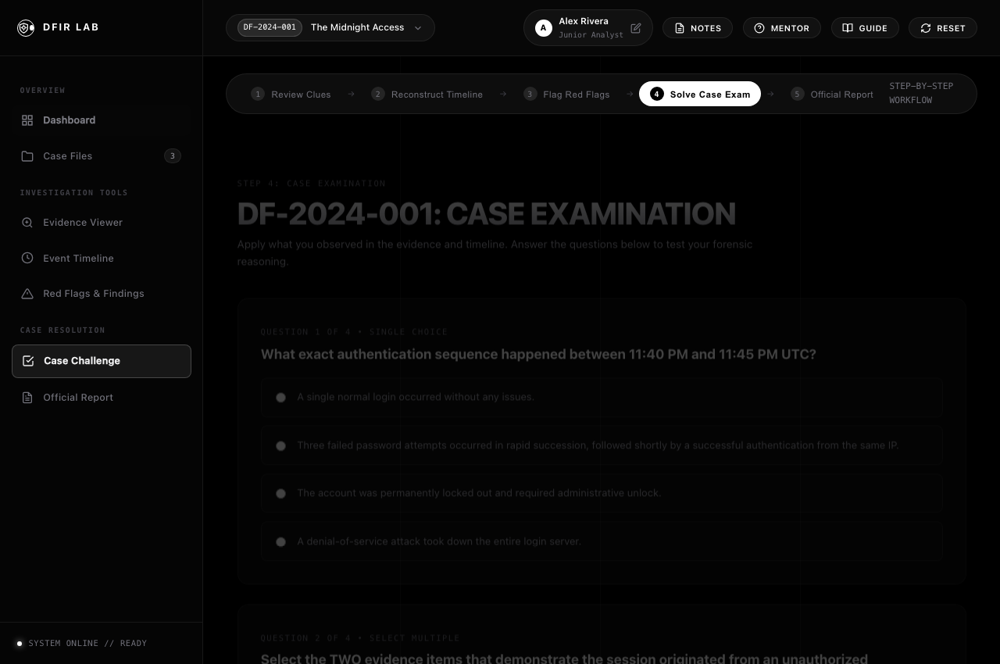
*Description:* The scenario-grounded examination module verifying investigative deductions, root-cause attribution, and remediation strategies with instant scoring feedback.

### Fig. 7.7. Official Incident Investigation Report

*Description:* The automated executive report generator compiling incident summaries, timeline findings, evidence audit tables, and examiner sign-offs into a printable deliverable.

---
\pagebreak

# CHAPTER 8: CONCLUSION & FUTURE ENHANCEMENTS

### 8.1 CONCLUSION
The **Digital Forensics Lab** mini-project successfully realizes a high-fidelity, educational, and technically authentic cybersecurity simulation platform. By eliminating the hardware and software configuration obstacles inherent in traditional forensic virtual machines, the platform allows students and security analysts to conduct authentic investigations directly within any modern web browser.

Key project milestones achieved:
* **Zero-Dependency Architecture:** Pure HTML5, modern CSS3 custom properties, and vanilla ES6+ JavaScript running completely client-side without server dependencies.
* **Realistic Case Simulations:** Three complete incident dossiers featuring heterogeneous raw telemetry (SSO, syslog, bash history, reverse proxy, and file systems).
* **Cryptographic Integrity:** Demonstration of chain of custody through SHA-256 checksums and immutable evidence tracking.
* **Dual-Layer Pedagogical Scaffolding:** Pairing raw JSON and RFC syslog strings with plain-English mentor translations.
* **Automated Deliverable Generation:** Dynamic compilation of case telemetry into audit-compliant, printable incident reports.

### 8.2 FUTURE ENHANCEMENTS
Future iterations of Digital Forensics Lab will expand upon this foundational architecture:
* **Live PCAP Stream Dissection:** Integrating a WebAssembly-compiled packet parser to inspect raw `.pcap` network capture files in browser memory.
* **AI-Powered Mentor Copilot:** Incorporating a localized LLM-driven assistant to deliver contextual hints and guided Socratic feedback during investigations.
* **Multi-User Collaborative Tabletop Mode:** Implementing WebRTC data channels to enable multi-analyst team collaboration on shared incident dossiers.
* **Memory Dump Volatility Simulator:** Simulating volatile memory forensics (e.g., injected DLL analysis, network sockets, and process trees).
* **Direct MITRE ATT&CK Mapping:** Linking observed evidence artifacts directly to standardized MITRE ATT&CK Enterprise Matrix technique IDs.

---
\pagebreak

# REFERENCES

1. **Carrier, B.**, *File System Forensic Analysis*, Addison-Wesley Professional, 1st Edition.
2. **National Institute of Standards and Technology (NIST)**, *Guide to Integrating Forensic Techniques into Incident Response*, NIST Special Publication 800-86, U.S. Department of Commerce.
3. **RFC 3227**, Brezinski, D. & Killalea, T., *Guidelines for Evidence Collection and Archiving*, Internet Engineering Task Force (IETF).
4. **MITRE Corporation**, *MITRE ATT&CK Enterprise Framework*, Available online at: [https://attack.mitre.org](https://attack.mitre.org)
5. **Mozilla Developer Network (MDN) Web Docs**, *Web Storage API, DOM APIs, and Modern JavaScript*, Available online at: [https://developer.mozilla.org](https://developer.mozilla.org)
6. **W3Schools Online Web Tutorials**, *HTML5, CSS3, and JavaScript Standard Documentation*, Available online at: [https://www.w3schools.com](https://www.w3schools.com)
