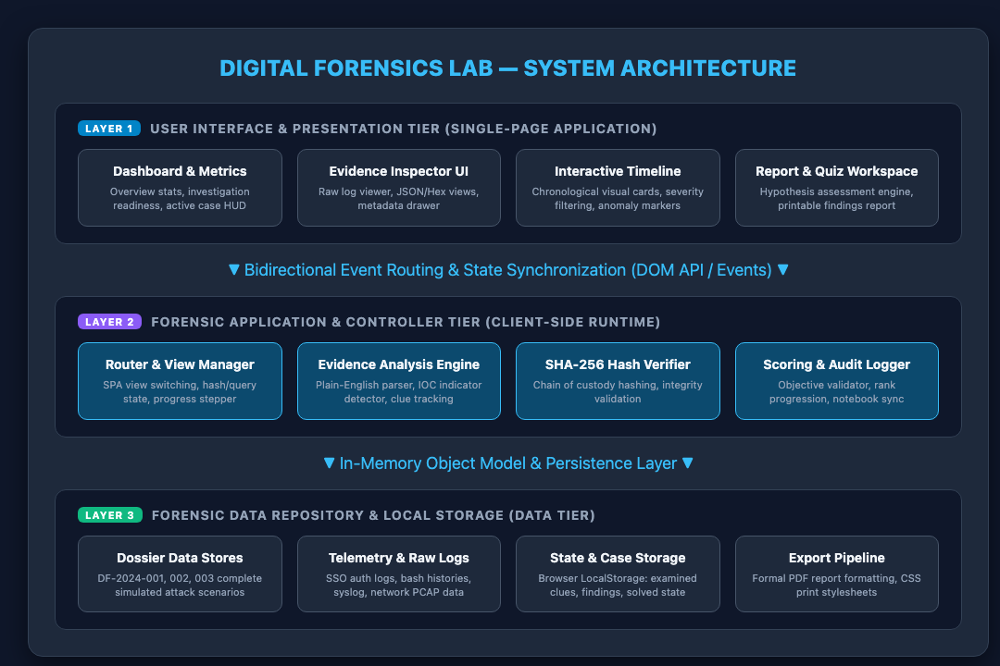
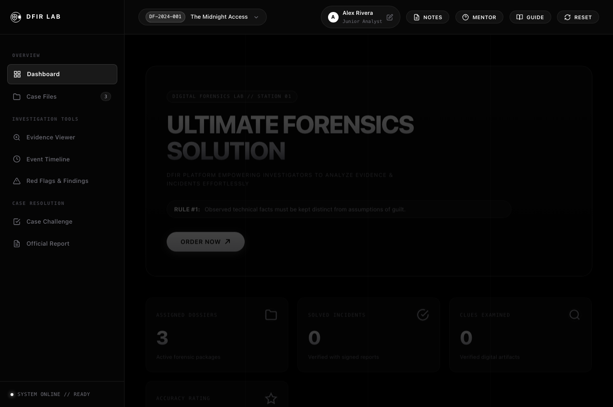
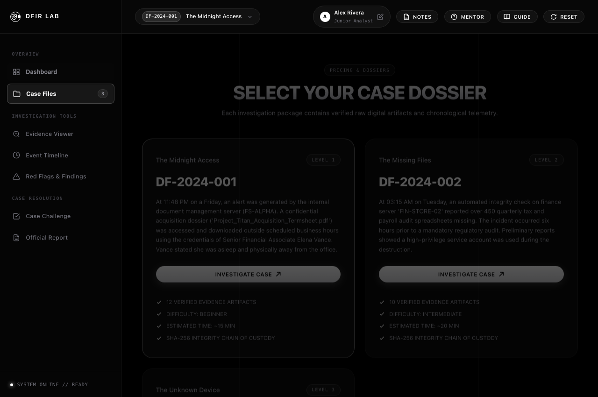
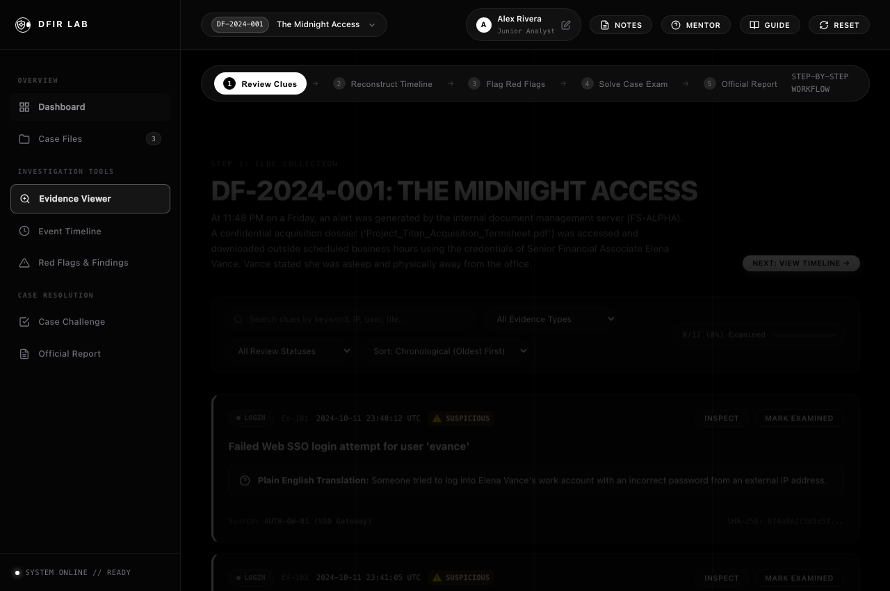
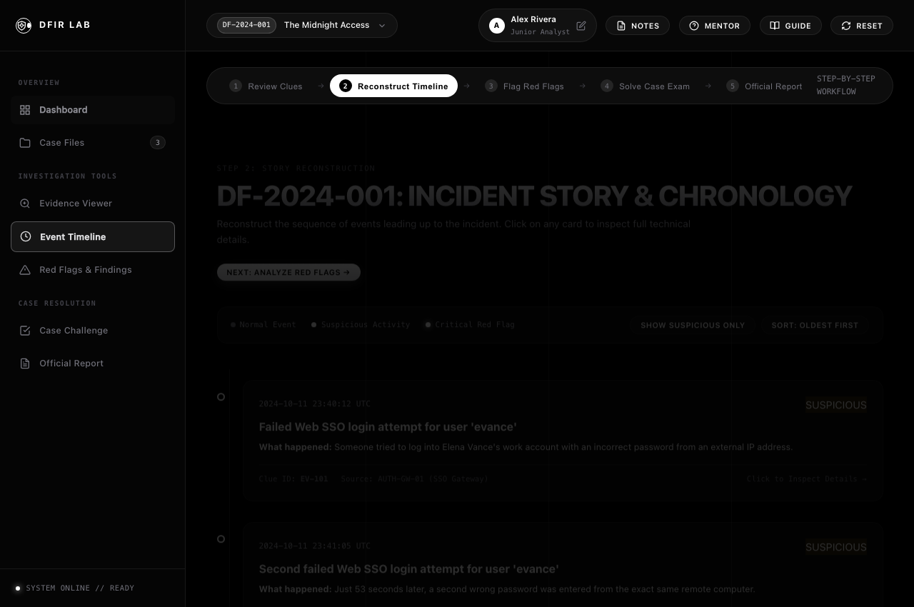
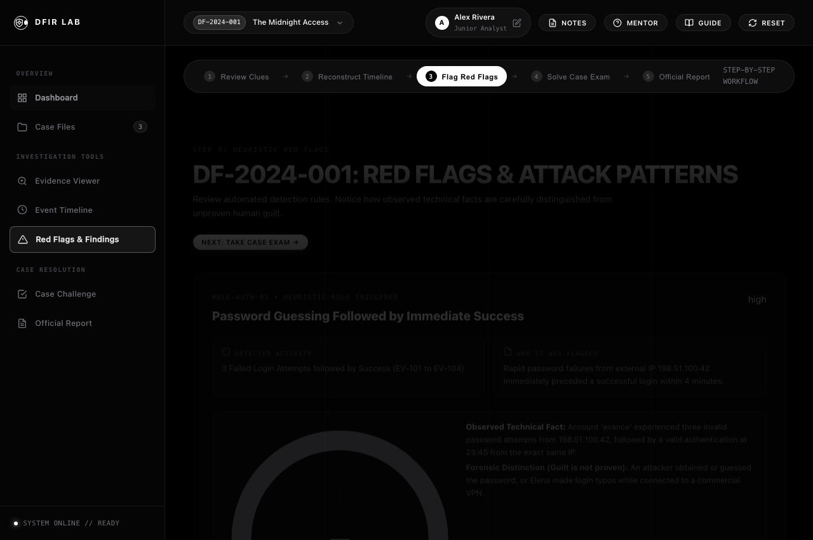
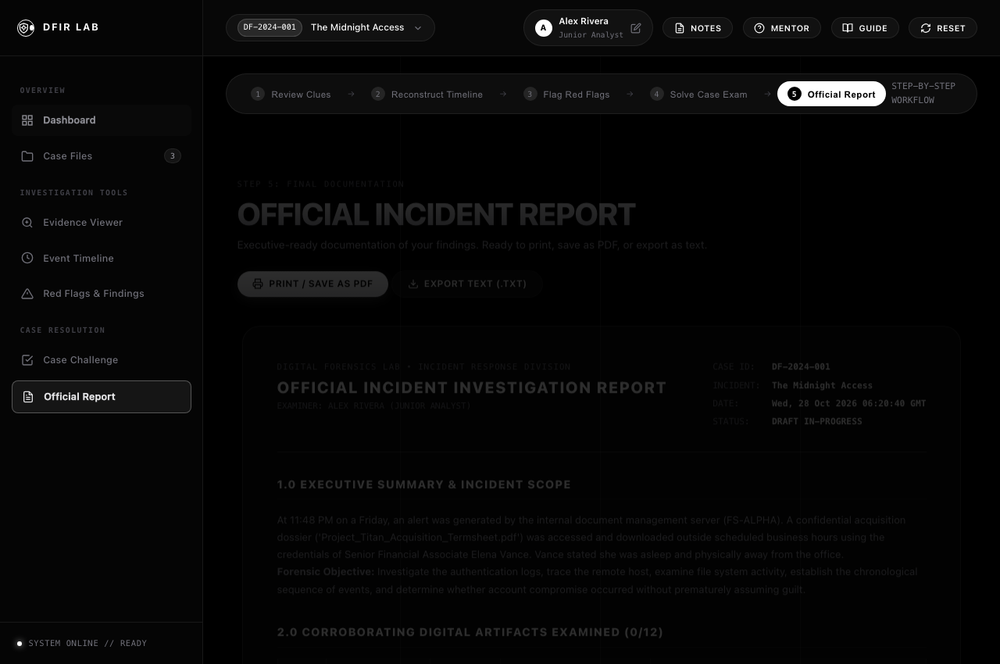

# 🔍 Digital Forensics Lab

> **Interactive Cybersecurity Incident Investigation & Evidence Analysis Simulator**  
> A zero-dependency, client-side educational simulation platform for digital forensics, timeline reconstruction, log analysis, and incident response.

[](LICENSE)
[](digital-forensics-lab/script.js)
[-brightgreen.svg)](#technology-stack)
[](#)

---

## 📌 Overview

**Digital Forensics Lab** is a high-fidelity, interactive cybersecurity training simulator built to bridge the gap between abstract forensic theory and hands-on investigative practice. Students and security analysts can investigate realistic security incidents, correlate multi-source logs, examine artifacts in an evidence locker, build chronological timelines, formulate hypotheses, and generate formal forensic investigation reports.

All forensic logic executes client-side with zero external dependencies, making it instantly deployable anywhere.

---

## 🚀 Key Modules & Capabilities

| Module | Description | Key Capabilities |
| :--- | :--- | :--- |
| **📁 Scenario Case Files** | Diverse real-world incident simulations | Unauthorized Exfiltration, Ransomware / C2 Beaconing, and Insider Threat scenarios. |
| **🔎 Evidence Locker** | Deep-dive artifact and log examination | SHA-256 cryptographic hashing, raw syslog/JSON view, and plain-English mentor explanations. |
| **⏱️ Chronological Timeline** | Multi-source event correlation | Zoomable timeline ordering network, authentication, and file-system logs chronologically. |
| **📝 Findings & Hypothesis** | Evidence-backed conclusion builder | Formulate root-cause hypotheses, tag supporting evidence, and track investigation confidence. |
| **🎯 Forensic Challenges** | Guided forensic knowledge check | Scenario-specific questions testing forensic artifact interpretation and chain-of-custody. |
| **📄 Executive Report Generator** | Formal incident reporting | Instantly compiles case data, evidence lists, findings, and analyst notes into an exportable report. |

---

## 📸 Screenshots & Architecture

### System Architecture


### Forensic Dashboard & Investigation Suite
| Dashboard & Overview | Case Selection |
| :---: | :---: |
|  |  |

| Evidence Locker & Log Analysis | Timeline Event Correlation |
| :---: | :---: |
|  |  |

| Findings & Conclusions | Case Reports |
| :---: | :---: |
|  |  |

---

## 🛠️ Technology Stack

- **Markup & Layout:** HTML5 (Semantic Structure, Accessible ARIA Landmarks)
- **Styling:** Vanilla CSS3 (Custom Dark Cyberpunk/Terminal Theme, Responsive Flexbox/CSS Grid, CSS Variables)
- **Application Engine:** Modern Vanilla JavaScript (ES6+, Functional State Management, 100% Dependency-Free)
- **Storage:** Volatile In-Memory & Web Storage API (`localStorage`) for saving investigation progress.

---

## 📖 Academic Documentation

This project includes a comprehensive mini-project report formatted according to Anna University academic standards:

- 📄 **Full PDF Report:** [`PROJECT_REPORT.pdf`](PROJECT_REPORT.pdf)
- 📝 **Markdown Report Source:** [`PROJECT_REPORT.md`](PROJECT_REPORT.md)
- 🌐 **HTML Printable Version:** [`PROJECT_REPORT.html`](PROJECT_REPORT.html)

---

## 💻 How to Run Locally

Since Digital Forensics Lab has **zero build steps and zero dependencies**, you can run it immediately:

### Option 1: Direct File Open
Simply double-click `index.html` or run:
```bash
open index.html
```

### Option 2: Local HTTP Server (Recommended)
```bash
# Using Python 3
python3 -m http.server 8000
```
Then open [http://localhost:8000](http://localhost:8000) in your web browser.

---

## 📄 License

This project is licensed under the [MIT License](LICENSE).
